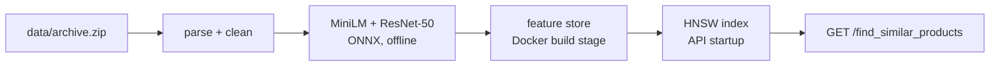

# Product similarity search (SAP CX technical exercise)

[](https://github.com/FairosMirza/sap-cxii-tech-ex-01_base/actions/workflows/ci.yml)

Given a product's `uniq_id`, return the most similar products in the 30k-product Amazon fashion catalogue.
All parts of the [assignment](ASSIGNMENT.md) are implemented, including the optional and bonus parts.

**Reviewers: start with the [solution report](docs/REPORT.md).** It has the requirements checklist, pipeline workflow, design decisions, results and verification evidence.

| Part | What | Where |
|---|---|---|
| 1 | `find_similar_products(product_id, num_similar)`: weighted multi-attribute similarity (brand, colour, price, list price, image, weight, rating, plus name text, category and shopper segment), deterministic tie-breaking | [similarity/engine.py](similarity/engine.py) |
| 2 | FastAPI microservice with proper HTTP errors, multi-stage Docker image, Kubernetes manifests | [app.py](app.py), [Dockerfile](Dockerfile), [k8s/](k8s/product-similarity.yaml) |
| 3 (bonus) | HNSW vector index (FAISS) with exact re-ranking, benchmarked against brute force | [similarity/ann.py](similarity/ann.py), [scripts/benchmark.py](scripts/benchmark.py) |
| Optional | Multimodal: MiniLM text and ResNet-50 image embeddings via ONNX Runtime (no PyTorch), configurable weights, fallbacks for missing data | [similarity/text.py](similarity/text.py), [similarity/images.py](similarity/images.py) |

Results:

- **Quality:** 73.5% of queries get at least one co-purchased product in the top 10 (name text alone: 69.0%). 96% of results share the query's category and 99% its shopper segment.
- **Speed:** HNSW with exact re-ranking matches exact search (recall@10 = 1.000) at 0.34 ms vs 1.13 ms per query. On 1M synthetic vectors it takes 0.21 ms vs 7.9 ms for brute force.
- **Deployment:** the container runs as non-root on a read-only filesystem, is ready in about 6 s and uses about 270 MiB. On Kubernetes, a rolling restart under continuous traffic produced 0 failed requests. 73 tests pass, and CI builds, deploys and tests everything on every push.

## Quick start

**Clone with Git LFS.** The precomputed embeddings are stored with [Git LFS](https://git-lfs.com). Install it before cloning (`brew install git-lfs` or `apt install git-lfs`, then `git lfs install`). If you already cloned without it, run `git lfs pull`.

**Docker**

```bash
docker build -t product-similarity:1.0.0 .
docker run --rm -p 8000:8000 product-similarity:1.0.0
curl "localhost:8000/find_similar_products?product_id=80e47075f39a4bdf6b83f2d7690c95fe&num_similar=5"
```

Interactive API docs: http://localhost:8000/docs

**Local (Python 3.12+)**

```bash
make setup   # .venv with requirements-dev.txt
make index   # feature store from data/archive.zip + the committed embeddings (~2 s)
make serve   # http://127.0.0.1:8000
make test
```

```python
from similarity.engine import find_similar_products
find_similar_products("80e47075f39a4bdf6b83f2d7690c95fe", 5)  # -> list of 5 uniq_ids
```

**Kubernetes (kind)**

```bash
make kind-deploy   # build image, create cluster, load image, apply k8s/, wait for rollout
make kind-smoke    # API checks + zero-downtime rolling restart under load
kubectl --context kind-similarity port-forward svc/product-similarity 8000:80
```

**Rebuild the embeddings from scratch.** This is optional because the results are committed in `artifacts/embeddings/`.

```bash
make models        # MiniLM + ResNet-50 ONNX models, pinned revisions -> models/
make images        # main image of each product, 224 px -> data/images/ (~235 MB, ~5 min)
make embeddings    # -> artifacts/embeddings/*.npz (~8 min on CPU)
make compare evaluate benchmark   # reproduce the tables in the report
```

## API

| Endpoint | Returns |
|---|---|
| `GET /find_similar_products?product_id=…&num_similar=…` | The required endpoint: JSON list of `uniq_id`s, most similar first |
| `GET /products/{product_id}/similar?num_similar=10` | The same search, with product details, score and each component's contribution to the score |
| `GET /health` | Liveness |
| `GET /ready` | Readiness (index loaded) plus index metadata |

Optional parameters on both search endpoints:
- `weights=text:0.5,image:0.3,brand:0.2` overrides the weights for one request. Components you leave out get weight 0.
- `method=exact|ann` picks brute force or HNSW. The default comes from `SEARCH_METHOD`, which is `ann` in the image.

| Status | When |
|---|---|
| 404 | Unknown `product_id` |
| 422 | Missing or invalid parameters: `num_similar` outside 1–100, malformed `product_id` (only `[A-Za-z0-9_-]`, ≤ 64 chars), bad `weights` or `method` |
| 503 | Index not loaded |
| 500 | Unexpected error: logged server-side, the response body is generic (no stack trace) |

Configuration through environment variables: `INDEX_DIR`, `SEARCH_METHOD` (`ann` or `exact`), `MAX_NUM_SIMILAR` (default 100).

## How it works



- **Representation:** each product is described by 10 components: name text, image, category, brand, shopper segment, colour, sale price, list price, weight and rating.
- **Scoring:** the score is a weighted average of the per-component similarities. Missing components are handled explicitly, and the weights can be changed per request.
- **Search:** HNSW (FAISS) fetches 100 candidates, and an exact scorer re-ranks them. Ties are broken by rating, then reviews, then price, then id.

The [report](docs/REPORT.md) explains each part in detail:
- [data cleaning](docs/REPORT.md#4-the-data-and-how-it-was-cleaned)
- [the similarity model, with a worked example](docs/REPORT.md#5-how-similarity-is-computed)
- [design decisions](docs/REPORT.md#6-design-decisions)
- [results](docs/REPORT.md#7-results)
- [Docker and Kubernetes verification](docs/REPORT.md#8-verification-tests-docker-kubernetes-ci)
- [technical appendix](docs/REPORT.md#appendix-technical-details)

## Project layout

```
app.py                  FastAPI service (Part 2)
similarity/
  data.py               streaming loader + cleaning
  features.py           component vectors, missing-value handling, feature store
  engine.py             exact scoring, ranking, find_similar_products (Part 1)
  ann.py                HNSW candidate generation (Part 3)
  build.py              builds the feature store (Docker build stage)
  text.py, images.py    offline embeddings (ONNX Runtime)
scripts/                download_models, download_images, embed, compare_text_models, evaluate, benchmark,
                        k8s_smoke_test.sh (+ k8s_smoke.py, run in-cluster)
tests/                  pytest suite
k8s/                    Deployment + Service
artifacts/embeddings/   precomputed MiniLM + ResNet-50 embeddings (Git LFS)
docs/REPORT.md          solution report for reviewers
.github/workflows/      CI: tests -> Docker build -> kind deploy -> zero-downtime smoke test
```

## References

See the [report](docs/REPORT.md#11-references): HNSW, FAISS, ANN-Benchmarks, product quantisation, ScaNN, MiniLM, Sentence-BERT, ResNet and LSA.
