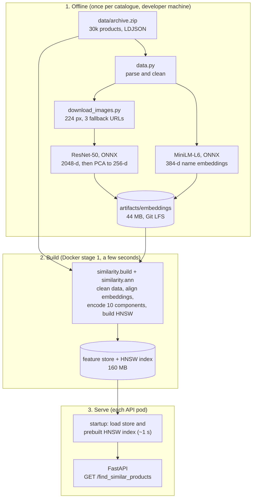
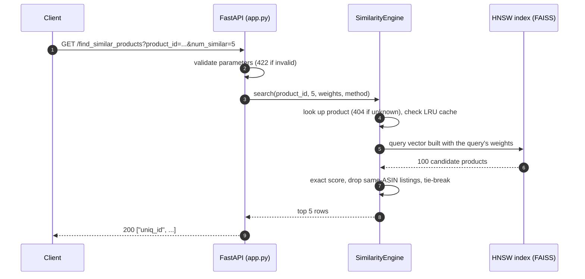
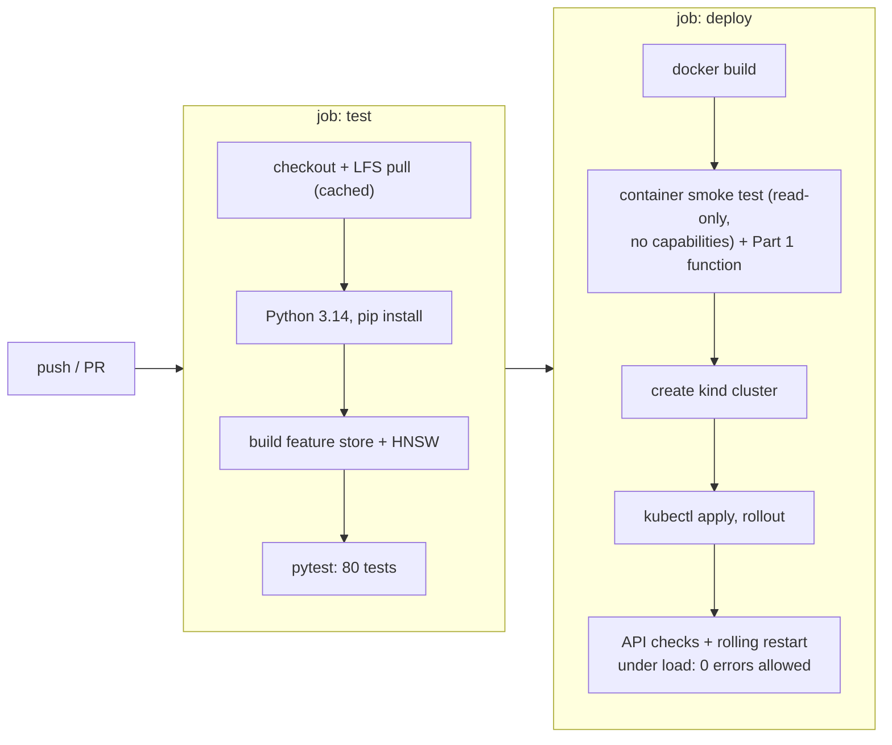

# Product Similarity Search: Solution Report

This report explains what was built for the [assignment](../ASSIGNMENT.md), how it works, the decisions behind it and the evidence that it works. The [README](../README.md) covers how to run it.

**Contents**
1. [Summary](#1-summary)
2. [Requirements checklist](#2-requirements-checklist)
3. [Pipeline workflow](#3-pipeline-workflow)
4. [The data and how it was cleaned](#4-the-data-and-how-it-was-cleaned)
5. [How similarity is computed](#5-how-similarity-is-computed)
6. [Design decisions](#6-design-decisions)
7. [Results](#7-results)
8. [Verification: tests, Docker, Kubernetes, CI](#8-verification-tests-docker-kubernetes-ci)
9. [Problems found and fixed](#9-problems-found-and-fixed)
10. [Limitations and next steps](#10-limitations-and-next-steps)
11. [References](#11-references)

Appendix: [Technical details](#appendix-technical-details)

---

## 1. Summary

**Task.** Given a product's `uniq_id`, return the `num_similar` most similar products from the 30,000-product Amazon fashion catalogue. Serve this as a FastAPI microservice that can run on Kubernetes. Bonus: make search scale with a vector index. Optional: combine text and image features.

**Approach.**
- Each product is described by **10 components**: name text, image, category, brand, shopper segment, colour, sale price, list price, weight and rating.
- The similarity of two products is a **weighted average** of their per-component similarities.
- Missing data is handled explicitly ([§5.3](#53-missing-data-the-fallback-mechanism)), so incomplete products are not systematically favoured or penalised.
- Text and image embeddings are computed **offline** with ONNX Runtime: MiniLM for names, ResNet-50 for images.
- The API serves precomputed vectors. An **HNSW index** finds candidates and an exact scorer ranks them.

**Results.**

| | |
|---|---|
| Quality | Of the 1,266 sampled queries that have co-purchase data, 73.5% get at least one co-purchased product in the top 10. 96% of results share the query's category and 99% its shopper segment. These are proxies, not measured relevance. |
| Speed | 0.33 ms per query with HNSW vs 1.42 ms for exact search (single-threaded). HNSW finds 99.96% of exact search's top-10 results; 4 of 1,000 lists differ. On 1M synthetic vectors: 0.21 ms vs 7.9 ms for brute force. |
| Robustness | 80 automated tests pass. The service runs on Kubernetes as 2 replicas. A rolling restart under continuous traffic produced **0 failed requests** out of 2,990, and again with 3 of the node's 4 CPUs saturated. |
| Deployment | A multi-stage Docker image (644 MB on disk, about 200 MB compressed, including the prebuilt index) builds in 2–6 minutes depending on network speed and is ready about 2 s after start. It runs as a non-root user on a read-only filesystem. CI builds it, deploys it to Kubernetes and tests it on every push to main and every pull request. |

---

## 2. Requirements checklist

| Requirement from the assignment | Status | Where | Evidence |
|---|---|---|---|
| **Part 1:** `find_similar_products(product_id, num_similar) -> List[str]` | Done | [similarity/engine.py](../similarity/engine.py) | `test_part1_function` |
| Use brand, colour, price, image, sales_price, weight, rating (others optional) | Done: all 7, plus name text, category and segment | [similarity/features.py](../similarity/features.py) | [ablation](#72-does-each-component-help) |
| Retrieve attributes → compare with all products → similarity measure → sort → top N | Done | `SimilarityEngine.scores`, `_rank` | `test_engine.py` |
| Tie-breaker (e.g. sales_price or rating) | Done: rating, then reviews, then price, then id | `_rank` | `test_ties_are_broken_by_rating` |
| A better data loader, an alternative to pandas | Done: streaming, typed, reads the zip directly | [similarity/data.py](../similarity/data.py) | `test_data.py` |
| **Part 2:** FastAPI `GET /find_similar_products` | Done | [app.py](../app.py) | `test_api.py`, Kubernetes smoke test |
| Enhance error handling with HTTP codes | Done: 404, 422, 503, 500 | [app.py](../app.py) | `test_invalid_requests_are_422` and others |
| Dockerfile deployable on Kubernetes | Done: multi-stage, non-root, probes | [Dockerfile](../Dockerfile), [k8s/](../k8s/product-similarity.yaml) | [§8.2](#82-docker), [§8.3](#83-kubernetes) |
| Optional: deploy on a local cluster | Done: kind, Kubernetes v1.37 | `make kind-deploy` | [§8.3](#83-kubernetes) |
| **Part 3 (bonus):** ANN vector search with paper references and rationale | Done: HNSW (FAISS) plus exact re-ranking | [similarity/ann.py](../similarity/ann.py) | [§7.3](#73-search-speed-part-3) |
| Multimodal: text features (TF-IDF / embeddings / transformers) | Done: TF-IDF, LSA and MiniLM compared, MiniLM chosen | [similarity/text.py](../similarity/text.py) | [§7.1](#71-text-model-tf-idf-vs-lsa-vs-minilm) |
| Multimodal: image features from a pre-trained CNN | Done: ResNet-50 | [similarity/images.py](../similarity/images.py) | [§7.2](#72-does-each-component-help) |
| Combine text and image; configurable weights; fallback for missing features | Done | `weights=` parameter, [§5.3](#53-missing-data-the-fallback-mechanism) | `test_weights_change_the_ranking`, `test_query_side_fallback_*` |
| Suggested: ANN library, dimensionality reduction, caching | Done: FAISS HNSW, PCA 2048→256, LRU cache | | |
| Explain design decisions and trade-offs | Done | [§6](#6-design-decisions), [§10](#10-limitations-and-next-steps) | |

---

## 3. Pipeline workflow

### 3.1 End to end

The pipeline has three phases:
- **Offline:** heavy work done once per catalogue (downloading images, running neural networks).
- **Build:** turns the raw data plus embeddings into a compact feature store and the HNSW vector index, inside the Docker build.
- **Serve:** loads the store and the prebuilt index, then answers requests.

| Stage | Command | Input | Output | Time | How often |
|---|---|---|---|---|---|
| Models | `make models` | Hugging Face (pinned revisions) | `models/` (ONNX) | ~1 min | once |
| Images | `make images` | image URLs | `data/images/` (235 MB) | ~5 min | once per catalogue |
| Embeddings | `make embeddings` | names, images | `artifacts/embeddings/` (44 MB) | ~8 min on CPU | once per catalogue |
| Feature store + index | `make index`, or Docker stage 1 | zip + embeddings | `artifacts/index/` | ~5 s each | every build |
| Serve | `make serve`, or the container | feature store + index | API with the index in memory | ready in ~2 s | per pod |
| Test | `make test` | code + feature store | 80 tests | ~10 s | every change |
| Deploy | `make kind-deploy` | image | 2 replicas | ~10 s rollout | per release |
| Smoke | `make kind-smoke` | running service | API checks + zero-downtime check | ~65 s | per release |

### 3.2 Life of a request

### 3.3 CI/CD workflow (GitHub Actions)

The workflow is [.github/workflows/ci.yml](../.github/workflows/ci.yml). It runs on every push to main and every pull request:

---

## 4. The data and how it was cleaned

Exploring the data turned up several problems. Each is handled in [similarity/data.py](../similarity/data.py):

| Field | What we found | How it is handled | Known for |
|---|---|---|---|
| `weight` | 79% of rows hold the placeholder `999999999`; units are mixed (g, Grams, Kilograms, Kg) | placeholder → unknown; converted to grams | 20.8% |
| `sales_price` | string in INR; missing for 10% | parsed to a number | 90.4% |
| list price ("price") | not in the data, but `discount_percentage` is | `sales_price / (1 − discount)` | 90.4% |
| `rating` | 25% are 5.0, often based on a single review | used as a weak signal; the review count breaks ties | 100% |
| `brand` | missing for 27%; case variants (`BIBA`/`Biba`); placeholders ("generic") | normalised; inferred from the start of the name if that brand appears on ≥ 2 products | 76.5% |
| colour | the `colour` field lists the colours of *other variants* | own colour from the URL slug (`…_Sea-Green_X-Large`), name or specs, 70% of products; if these disagree, every colour found is kept. Where none is found, the listing's variant colours are used instead (another 10%). They are weaker evidence about this listing's own colour, but they get the same colour weight: no confidence discount is applied. 15 colour families | 79.3% |
| category | missing for 15% | filled from the most common category of the product's browse node (95.8% agreement) | 99.6% |
| segment | not a field | from the category prefix (`Womens…`) or the name (women/men/girls/boys/kids/baby/unisex) | 98.8% |
| images | some links are dead (404) | falls back to the product's 2nd and 3rd image | 99.6% |
| `asin` | 451 products are listed 2–3 times under different `uniq_id`s | the query's duplicates are never returned; at most one result per ASIN | |

---

## 5. How similarity is computed

### 5.1 Components and default weights

| Component | What is compared | Similarity | Weight |
|---|---|---|---|
| text | product name, embedded by MiniLM | cosine | 0.30 |
| image | main photo, embedded by ResNet-50 (PCA 256) | cosine | 0.20 |
| category | most specific category | same = 1 | 0.15 |
| brand | normalised brand | same = 1 | 0.10 |
| segment | women / men / girls / boys / kids / baby / unisex | same 1, related 0.5 | 0.05 |
| colour | colour families (own colour, else the variant list at the same weight) | overlap | 0.05 |
| sales_price | log price | 1 if equal, ≈ 0.81 at 2× apart, −1 at the extremes | 0.08 |
| price (list) | log list price | same scale | 0.02 |
| weight | log grams | same scale | 0.02 |
| rating | rating | same scale | 0.03 |

The score is a weighted average over the components the query has:

$$\text{score}(q, c) = \frac{\sum_k w_k\, s_k(q, c)}{\sum_k w_k}$$

### 5.2 Worked example

Query: **"Brown Faux Leather Jacket for Man"** (Leather Retail, ₹1,669). This product has no known weight, so the weight component is dropped and the other weights are rescaled to sum to 1. The table shows each component's contribution to the final score, taken from `GET /products/{id}/similar`:

| # | Result | Score | text | image | category | brand | segment | colour | price (sale + list) | rating |
|---|---|---|---|---|---|---|---|---|---|---|
| 1 | Leather Retail Black Faux Leather Jacket (₹1,499) | 0.820 | 0.228 | 0.118 | 0.153 | 0.102 | 0.051 | 0.036 | 0.101 | 0.030 |
| 2 | Leather Retail Black Plain Faux Leather Jacket for Man (₹1,599) | 0.811 | 0.262 | 0.116 | 0.153 | 0.102 | 0.051 | 0.000 | 0.097 | 0.030 |
| 3 | Leather Retail Army Colour Faux Leather Jacket for Man (₹1,699) | 0.795 | 0.248 | 0.113 | 0.153 | 0.102 | 0.051 | 0.000 | 0.097 | 0.030 |

Result 1 ranks first despite a slightly weaker name match because it scores on colour. Its data is contradictory: the URL names a brown variant while the title says black, and both colours are kept. Results 2 and 3 are black and army green, so they get no colour credit.

### 5.3 Missing data (the fallback mechanism)

- **The query lacks a component.** The component is dropped and the remaining weights are rescaled. For example, a product without a photo is matched on text and attributes only.
- **A candidate lacks a component.** For text, image, colour, segment and the numeric components it gets the component's *average* vector, so it scores the *expected* similarity on that component. An unknown brand or category never matches (scores 0). Random products share a brand only 0.2% of the time and a category 4.7%, so this costs at most about 0.007 of the score.
- **A whole embedding file is missing.** The build falls back to TF-IDF + LSA for text and turns the image component off.

### 5.4 Ranking rules

- The query product and other listings of the same ASIN are never returned.
- At most one result per ASIN.
- Ties (equal to 6 decimals) are broken by higher rating, then more reviews, then lower price, then `uniq_id`. Results are therefore deterministic.
- Results are cached in an LRU cache, which is safe because the catalogue is static.

---

## 6. Design decisions

The [decision summary](DECISION.md) compares each choice with the simplest alternative and lists what it costs.

| Decision | Alternatives considered | Why |
|---|---|---|
| Weighted per-component similarity | One big embedding; a learned model | Explainable (each component's contribution can be shown), every weight can be tuned, and no training labels are needed |
| MiniLM for text | TF-IDF, LSA | Best category and segment agreement in [§7.1](#71-text-model-tf-idf-vs-lsa-vs-minilm); computed offline, so it adds nothing at query time |
| ONNX Runtime instead of PyTorch | PyTorch / sentence-transformers | Much smaller install, and no clash between PyTorch's and FAISS's bundled OpenMP libraries |
| ResNet-50 for images | CLIP, EfficientNet | The pre-trained CNN the assignment suggests; CLIP is the obvious next step |
| Prices encoded as angles | Feature scaling + Euclidean distance | Keeps every component an inner product, so all components fit in one vector index |
| HNSW + exact re-ranking | Brute force, IVF-PQ, Annoy, ScaNN | Top recall/speed trade-off for in-memory data, incremental inserts, few settings; the exact re-rank keeps all ranking rules in one place |
| Precomputed embeddings in Git LFS | Compute in the Docker build; artifact store | Reproducible build without 30k image downloads or ML frameworks in the image |
| HNSW index built at image build time | Build at pod startup | Pods load it in ~1 s instead of spending 14–33 s building it under a 1-CPU limit, which caused restart loops on a busy node ([§9](#9-problems-found-and-fixed)) |
| Serving image without ML libraries | One image with everything | Smaller attack surface and image; offline and online code are clearly separated |
| One uvicorn worker per pod | Several workers per pod | Kubernetes scales replicas; each pod stays simple and predictable |
| Python 3.14 | Python 3.10 (in the sample Dockerfile) | 3.10 reaches end of life in October 2026 |

---

## 7. Results

### 7.1 Text model: TF-IDF vs LSA vs MiniLM

Setup: 3,000 random products. Trivial neighbours (same product, same ASIN, identical name) are excluded.

| Method | category@10 | segment@10 | co-purchase hit@10 | Embedding time |
|---|---|---|---|---|
| TF-IDF (words + character n-grams) | 0.632 | 0.858 | 0.530 | 1.9 s |
| LSA (TF-IDF → SVD 256) | 0.672 | 0.851 | 0.419 | 7.9 s |
| **MiniLM-L6-v2 (chosen)** | **0.710** | **0.888** | 0.537 | 26.7 s (offline) |

### 7.2 Does each component help?

Setup: 2,000 random queries, top 10. There are no relevance labels, so these are proxies:
- **co-purchase hit@10:** among the 1,266 queries whose "customers also bought" list matches catalogue products, the share with at least one of them in the top 10. The other 734 queries have no usable list; they are left out, not counted as misses. The list is never used as a feature, so the metric doesn't reuse a scoring input.
- **brand@10:** share of results from the same brand. Lower means more variety.

| Weights | co-purchase hit@10 | category@10 | segment@10 | brand@10 |
|---|---|---|---|---|
| text only | 0.690 | 0.739 | 0.899 | 0.434 |
| image only | 0.299 | 0.574 | 0.824 | 0.086 |
| structured attributes only | 0.530 | 0.991 | 0.994 | 0.445 |
| default without text | 0.585 | 0.985 | 0.991 | 0.410 |
| default without image | 0.719 | 0.963 | 0.989 | 0.469 |
| **default (all components)** | **0.735** | 0.964 | 0.987 | 0.452 |

- Text matters most: removing it costs 15 points.
- Images help a little (+1.6 points).
- The structured attributes keep results in the right category, segment and price band.

### 7.3 Search speed (Part 3)

**Real catalogue** (30k products, 1,000 single queries, single-threaded as in the container):

| Method | recall@10 vs exact | top-10 lists differing | p50 latency |
|---|---|---|---|
| exact (brute force) | 1.0000 | 0 | 1.42 ms |
| **HNSW, 100 candidates re-ranked (default)** | **0.9996** | **4 of 1,000** | **0.33 ms** |

HNSW is approximate. The exact re-rank orders the candidates HNSW fetched, but it can't recover a product HNSW missed. `method=exact` gives exhaustive results.

**Scale test** (synthetic 128-d vectors around the real ones, single thread):

| Catalogue size | brute force | HNSW (ef=128) | recall@10 |
|---|---|---|---|
| 100k | 0.74 ms | 0.12 ms | 0.999 |
| 1M | 7.90 ms | 0.21 ms | 1.000 |

Brute-force cost grows linearly with the catalogue size, while HNSW stays nearly flat.

**Why HNSW.** HNSW ([Malkov & Yashunin](https://arxiv.org/abs/1603.09320)) builds a layered "small world" graph and searches it greedily from coarse to fine layers.
- Search cost grows roughly logarithmically with the number of items.
- It is consistently at or near the top of [ANN-Benchmarks](https://arxiv.org/abs/1807.05614) for in-memory data.
- New items can be inserted without retraining.

The other options are better suited elsewhere:
- **IVF-PQ** compresses vectors; it is the better choice above about 100M items or when memory is tight.
- **Annoy** must be rebuilt to add items and has lower recall.
- **Brute force** is fine up to about 100k items.

---

## 8. Verification: tests, Docker, Kubernetes, CI

Local checks were run between 2026-10-23 and 2026-10-27 on macOS arm64, with Docker via Colima (4 CPUs, 6 GB) and kind v0.33 (Kubernetes v1.37). CI runs are linked in [§8.4](#84-continuous-integration).

### 8.1 Automated tests: 80 passing (`make test`)

| Suite | What it proves |
|---|---|
| `test_data.py` (38) | Every parsing rule: prices, units, segments, colours, image URLs, zip loading, brand and category inference, the Git LFS pointer guard |
| `test_engine.py` (19) | Exclusion and deduplication, ranking, weights, fallbacks, tie-breaking, explanations, caching, save/load, HNSW = exact on a small catalogue, saved index reused only with matching settings and data, result count kept when duplicate listings exhaust the HNSW candidates, Part 1 function honours `INDEX_DIR` |
| `test_api.py` (17) | 200 / 404 / 422 / 503 / 500 responses, the weights and method parameters, the explanation endpoint |
| `test_integration.py` (4) | On the real data: the Part 1 function, HNSW recall ≥ 0.98, sensible neighbours, the API serving the real index |
| `test_images.py` (2) | Two workers downloading the same image URL at once both succeed; a failed write leaves no temporary file |

### 8.2 Docker

| Check | Result |
|---|---|
| `docker build .` with the real Dockerfile (packages from PyPI) | Passed in 1 min 46 s with a cold dependency cache on a fast connection; a separate no-cache rebuild with slow PyPI downloads took 6 min 20 s. The feature store and HNSW index (about 5 s each) are built inside the image |
| Image contents | 644 MB on disk, about 200 MB compressed (what a registry stores): Debian slim + Python ≈ 160 MB, Python packages 123 MB, feature store + HNSW index 160 MB, code < 0.1 MB |
| Run with `--read-only --cap-drop ALL` | Ready about 2 s after start (index loaded in 0.5–0.7 s), 270 MiB memory, runs as UID 10001 |
| Part 1 function inside the image | `find_similar_products` returns the same 5 IDs as the HTTP API (also checked in CI) |
| Endpoints | 200 for a known product; 404 unknown product; 422 for `num_similar=0`, `num_similar=1000` and bad weights |
| Clone without Git LFS | The build stops with a clear message to run `git lfs install && git lfs pull` |
| Fresh clone from GitHub | Without LFS the build stops at the guard as intended; after `git lfs install && git lfs pull` the clone builds and returns the same results |

### 8.3 Kubernetes

| Check | Result |
|---|---|
| Manifest schema validation (strict, Kubernetes 1.37) | Passed for the Deployment and the Service |
| `kubectl apply` + rollout of 2 replicas | Rollout in 9 s; each pod Ready 2–4 s after start, 0 restarts |
| Requests through the Service | Correct ids; 404 / 422 as expected; `/ready` reports 30,000 products and both embedding models |
| Inside a pod | `uid=10001`, writing to `/app` fails (read-only filesystem), `/tmp` is writable, scikit-learn is absent |
| **Zero downtime:** continuous requests during `kubectl rollout restart` | Without `preStop`: 12 of 2,575 requests failed. With a 5 s `preStop` sleep: **0 of 2,990** failed (p50 1.4 ms, p99 19 ms) |
| `make kind-smoke`, the repeatable version used in CI | Functional checks OK; 2,453 / 2,453 requests succeeded during the rollout |
| **Stress:** the same test with a pod burning 3 of the node's 4 CPUs | 2,594 / 2,594 requests succeeded; new pods loaded the index in 0.7–1.2 s, 0 restarts |
| Re-check after the code-review fixes (2026-10-27) | 2,708 / 2,708 requests succeeded during the rollout; pods loaded the index in 0.8–0.9 s, 0 restarts; the Part 1 function returns 5 IDs inside a running pod |

### 8.4 Continuous integration

Every push to main and every pull request runs the [workflow](../.github/workflows/ci.yml) shown in [§3.3](#33-cicd-workflow-github-actions). All runs and their full logs: [GitHub Actions](https://github.com/FairosMirza/sap-cxii-tech-ex-01_base/actions/workflows/ci.yml). The status badge is in the [README](../README.md).

The first run, on the commit that published the repo ([logs](https://github.com/FairosMirza/sap-cxii-tech-ex-01_base/actions/runs/40338592980)), passed:

| Job | Duration | Result |
|---|---|---|
| Tests (unit, API, integration) | 1 min 1 s | 73 passed in 14 s (tests added later run in later CI runs) |
| Docker image + Kubernetes (kind) | 3 min 6 s | image built; container smoke test OK; rolled out on kind; functional checks OK; **2,600 / 2,600** requests succeeded during the rolling restart (p50 1.9 ms, p99 16 ms) |

---

## 9. Problems found and fixed

| Problem | How it was found | Fix | Outcome |
|---|---|---|---|
| 79% of weights are a fake value (`999999999`) | data profiling | treated as unknown, with the fallback | no fake values in the scores |
| The `colour` field describes other variants | data profiling | own colour read from the URL and name | colour known for 79% |
| 451 products listed twice or three times | data profiling | duplicates excluded from results | no duplicate results |
| Some image links are dead | download run | try the product's other images | images for 99.6% |
| FAISS and scikit-learn each bundle their own OpenMP library | inspecting loaded libraries | scikit-learn kept out of the API | one OpenMP runtime in production |
| Rolling restarts dropped 0.47% of requests | in-cluster load test | `preStop` sleep of 5 s | 0 failed requests |
| Pods restarted in a loop (19 restarts) after the laptop had been asleep and busy | `kubectl get pods`, events: startup probe timeouts, exit 137 | each pod was building the HNSW index at startup (14–33 s under a 1-CPU limit, with OpenMP using 4 threads); the index is now built once in the Docker build and loaded at startup, `OMP_NUM_THREADS=1`, probe timeouts of 3 s and a 120 s startup budget | startup 14–33 s → ~1 s; 0 restarts and 0 failed requests in a rollout with 3 of 4 CPUs saturated |
| The Part 1 function ignored `INDEX_DIR`, so it failed when called inside the Docker image (the HTTP API was fine) | code review | one `index_dir()` setting used by the API, the function and the build; CI calls the function inside the image | works locally, in the image and in a pod |
| A saved HNSW index was reused for different data of the same size | code review | the feature store carries a content fingerprint, and the index is rebuilt when it doesn't match | regression test with reordered data |
| HNSW could return fewer than `num_similar` results when many listings share the query's ASIN (synthetic case; the real data has at most 3 per ASIN) | code review | fall back to exact search when the candidates run out | regression test |
| Two products sharing an image URL could make two download workers write the same temporary file; one then failed with `FileNotFoundError`, stopping the optional image rebuild | code review | each download attempt writes its own temporary file, then atomically replaces the destination | regression test forces the collision; serving and the committed embeddings were never affected |
| A tie-break test passed for the wrong reason (ids happened to sort the same way) | test review | test data where id order and rating order disagree | the test now proves the rating tie-break |
| A clone without Git LFS gives placeholder files | review of the LFS change, then a fresh clone from GitHub | the build detects them and explains the fix (`git lfs install && git lfs pull`) | clear error instead of a confusing crash |

---

## 10. Limitations and next steps

- **No ground-truth labels.** Weights were set by hand and checked with proxies. With click or purchase data, the next step is to learn the weights and validate with A/B tests.
- **Generic image model.** ResNet-50 (ImageNet) sees shape and colour but not style. CLIP or a fashion-tuned model should improve results and would allow text-to-image search.
- **Static catalogue.** Updates mean a rebuild and a rolling deploy. For frequent updates, use HNSW's incremental inserts or a vector database (e.g. SAP HANA Cloud Vector Engine, pgvector).
- **Scale.** The HNSW index is built at image build time (4.9 s for 30k products) and memory-loaded at startup. For millions of products, use compressed vectors (HNSW-SQ or IVF-PQ) and memory-map the index.
- **Production hardening.** Add authentication, TLS and rate limiting at the ingress, an HPA and a PodDisruptionBudget, and metrics and tracing.
- **Variety.** 45% of results share the query's brand. That suits "more like this"; a discovery use case would lower the brand weight, which the `weights` parameter already supports.

---

## 11. References

1. Malkov & Yashunin, *Efficient and robust approximate nearest neighbor search using Hierarchical Navigable Small World graphs*, IEEE TPAMI 2020. [arXiv:1603.09320](https://arxiv.org/abs/1603.09320)
2. Johnson, Douze & Jégou, *Billion-scale similarity search with GPUs*, IEEE Trans. Big Data 2019. [arXiv:1702.08734](https://arxiv.org/abs/1702.08734)
3. Douze et al., *The Faiss library*, 2024. [arXiv:2401.08281](https://arxiv.org/abs/2401.08281)
4. Aumüller, Bernhardsson & Faithfull, *ANN-Benchmarks*, Information Systems 2020. [arXiv:1807.05614](https://arxiv.org/abs/1807.05614)
5. Jégou, Douze & Schmid, *Product quantization for nearest neighbor search*, IEEE TPAMI 2011.
6. Guo et al., *Accelerating Large-Scale Inference with Anisotropic Vector Quantization* (ScaNN), ICML 2020. [arXiv:1908.10396](https://arxiv.org/abs/1908.10396)
7. Wang et al., *MiniLM: Deep Self-Attention Distillation for Task-Agnostic Compression of Pre-Trained Transformers*, NeurIPS 2020. [arXiv:2002.10957](https://arxiv.org/abs/2002.10957)
8. Reimers & Gurevych, *Sentence-BERT*, EMNLP 2019. [arXiv:1908.10084](https://arxiv.org/abs/1908.10084)
9. He et al., *Deep Residual Learning for Image Recognition*, CVPR 2016. [arXiv:1512.03385](https://arxiv.org/abs/1512.03385)
10. Deerwester et al., *Indexing by latent semantic analysis*, JASIS 1990.

---

## Appendix: Technical details

### A.1 Encodings and why

- **Text and image:** the embeddings are centred (dataset mean subtracted) and L2-normalised, so cosine similarity is a plain inner product. Centring also makes the average similarity about 0, which is what the candidate-side fallback relies on.
- **Numbers as angles:** a value is scaled to t ∈ [0, 1] between the 1st and 99th percentile and mapped to the unit vector (cos πt, sin πt). Two values then have similarity cos(π·Δt): 1 when equal, ≈ 0.81 for prices 2× apart, −1 at opposite ends.
  - Prices and weights use a log scale, so ₹100 vs ₹200 is as far apart as ₹1,000 vs ₹2,000.
  - Clipping at the percentiles stops outliers from squeezing all other values together.
  - Because each comparison is an inner product, numbers fit in the same vector index as the embeddings.
- **Segment:** each segment is a row of a positive semi-definite similarity matrix (1 = same, 0.5 = related, 0 = unrelated), factorised with an eigendecomposition. The inner product of two rows reproduces the matrix entry.
- **Colour:** an L2-normalised multi-hot vector over 15 colour families. Its inner product is the Ochiai overlap of the two colour sets.
- **Missing values:** a candidate with an unknown dense or numeric component gets the component's mean vector, so its score is the expected similarity. Unknown brand and category codes never match (score 0); the expected match rate for random products is only 0.2% and 4.7%. A query with an unknown component drops it, and the other weights are rescaled.

### A.2 One vector for the index

Each product is packed into one vector using the default weights $w$. The query vector carries the query's own weights $w'$, which are renormalised and may come from the request:

$$x_c = \big[\sqrt{w_k}\, v_k(c)\big]_k, \qquad y_q = \Big[\tfrac{w'_k}{\sqrt{w_k}}\, v_k(q)\Big]_k \quad\Rightarrow\quad \langle x_c, y_q\rangle = \sum_k w'_k\, s_k(q, c)$$

- **Nearly the same score as exact search:** for text, image, colour, segment and the numeric components the inner product equals the exact score, and per-request weights work without rebuilding the index. Brand and category use random codes (next bullet), so for them the index score is approximate (differences up to about 0.03 in tests).
- **Random codes for one-hot components:** brand and category are one-hot in the exact scorer (6.3k + 250 dimensions). In the index they become random 64-d unit codes, whose inner product is about 0 (standard deviation 0.125) for different values. That noise only affects which candidates are fetched, because the exact scorer re-scores them.
- **Index settings:** HNSW with `M=32`, `efConstruction=200` and `efSearch=100`, using inner product. 30k products × 798 dimensions (91 MB of vectors).
- **Lifecycle:** `python -m similarity.ann` builds the index once in the Docker build stage and saves it with its build settings. At startup a pod loads it (~1 s) only if its settings and the feature store's content fingerprint both match, and rebuilds it otherwise, so a stale index is never used silently.

### A.3 Full benchmark (`make benchmark`)

Real catalogue, 1,000 single queries, single-threaded (as in the container), measured 2026-10-27:

| Method | recall@10 vs exact | top-10 lists differing | p50 | p95 |
|---|---|---|---|---|
| exact brute force (numpy) | 1.0000 | 0 | 1.42 ms | 1.71 ms |
| HNSW, 20 candidates re-ranked | 0.9975 | 23 | 0.21 ms | 0.34 ms |
| HNSW, 50 candidates | 0.9986 | 14 | 0.22 ms | 0.29 ms |
| **HNSW, 100 candidates (default)** | **0.9996** | **4** | **0.33 ms** | 0.44 ms |
| HNSW, 200 candidates | 0.9997 | 3 | 0.54 ms | 0.69 ms |
| HNSW, 400 candidates | 0.9999 | 1 | 0.94 ms | 1.22 ms |

Scale-up: synthetic 128-d vectors sampled around the real product vectors, single-thread search:

| N | brute force p50 | HNSW ef=64: p50 / recall@10 | HNSW ef=128: p50 / recall@10 | HNSW build (8 threads) |
|---|---|---|---|---|
| 100k | 0.74 ms | 0.06 ms / 0.998 | 0.12 ms / 0.999 | 1 s |
| 1M | 7.90 ms | 0.14 ms / 0.998 | 0.21 ms / 1.000 | 18 s |

The synthetic data is clustered, which is easy for HNSW. Recall should be measured again on real data at that scale.

### A.4 Alternatives to HNSW, dimensionality reduction, caching

- **IVF-PQ** ([Jégou et al.](https://doi.org/10.1109/TPAMI.2010.57)) compresses each vector to 16–64 bytes. It is the right choice at 100M+ vectors or tight memory, but loses some recall and needs a training step.
- **[ScaNN](https://arxiv.org/abs/1908.10396)** is very fast for maximum inner product search but is heavier to integrate and operate.
- **Annoy** is simple and memory-mappable, but has lower recall at the same speed and must be rebuilt to add items.
- **Brute force** is exact and simplest. It is fine up to roughly 100k items: about 1 ms here.
- **[FAISS](https://arxiv.org/abs/2401.08281)** provides both HNSW and the exact baseline, plus an upgrade path (HNSW with 8-bit scalar quantisation, IVF-PQ, GPU).
- **Dimensionality reduction:** PCA on the image embeddings (2048 → 256 keeps 88.4% of the variance). t-SNE was not used: it is a 2-D visualisation method, can't project new points and doesn't preserve global distances.
- **Caching:** each pod keeps an LRU cache of results. Because the catalogue is static, the top-100 neighbours of every product could also be precomputed offline (30k × 100 IDs) and served from a key-value store.

### A.5 Full ablation (`make evaluate`)

Price ratio is the median |log2(result price / query price)|; 1.0 means 2× apart.

| Weights | co-purchase hit@10 | category@10 | segment@10 | brand@10 | price ratio |
|---|---|---|---|---|---|
| text only | 0.690 | 0.739 | 0.899 | 0.434 | 0.39 |
| image only | 0.299 | 0.574 | 0.824 | 0.086 | 0.56 |
| structured attributes only | 0.530 | 0.991 | 0.994 | 0.445 | 0.18 |
| text + image | 0.722 | 0.776 | 0.912 | 0.395 | 0.38 |
| default without image | 0.719 | 0.963 | 0.989 | 0.469 | 0.27 |
| default without text | 0.585 | 0.985 | 0.991 | 0.410 | 0.28 |
| default without brand | 0.722 | 0.977 | 0.990 | 0.352 | 0.29 |
| **default** | **0.735** | 0.964 | 0.987 | 0.452 | 0.29 |

Caveats on the proxies:
- Co-purchase is not the same as similarity, because complementary items are bought together too.
- Co-purchased products are matched by name, which is ambiguous for generic names.
- Category@10 is partly circular when the category component is on.

Use the numbers to compare configurations, not as an absolute quality score.

### A.6 Text and image pipelines

- **TF-IDF:** word 1–2 grams plus character 3–5 grams, each L2-normalised and weighted equally, so "tshirt" matches "t-shirt". LSA is a truncated SVD to 256 dimensions. Averaging TF-IDF and MiniLM scores reached the best co-purchase hit (0.551), but it was not adopted: it has lower category agreement (0.689) than MiniLM alone and makes the build more complex.
- **MiniLM:** `sentence-transformers/all-MiniLM-L6-v2` exported to ONNX and run with the `tokenizers` library (max 64 tokens, mean pooling). The 30k names take 27 s on CPU.
- **Images:**
  - Each product's 224 px rendition is padded to a white square rather than cropped, because garments are often tall.
  - ImageNet normalisation, then ResNet-50 (ImageNet weights) global-pool features (2048-d) via ONNX Runtime.
  - L2-normalised and reduced with PCA to 256-d, then centred and normalised again.
  - 29,885 of 30,000 products have an image after the fallbacks; embedding takes 7.5 min on CPU.

### A.7 Other trade-offs

- **Brand vs variety:** 45% of results share the query's brand. Without the brand component this drops to 35%, at a cost of 1.3 points of co-purchase hit.
- **Rating:** it describes quality, not the product itself, so it gets a small weight and mainly breaks ties. Many 5.0 ratings come from a single review.
- **Variants:** products with the same name in another colour or size are separate products and are returned. Exact duplicates (same ASIN) are not. Grouping variants would be a product decision.
